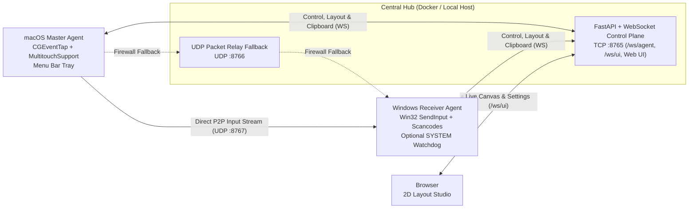

# MultiControl — Seamless Mac-to-Windows KVM & 2D Layout Studio

[](https://github.com/Nantaphat-Yoktaworn/multiControl/actions/workflows/ci.yml)


**MultiControl** is a low-latency software KVM that lets you share your **Mac keyboard, mouse, and Multi-Touch trackpad** seamlessly with a **Windows PC** across your LAN or VPN — complete with an interactive **2D Screen Layout Studio**, physical monitor size calibration, hardware scancode injection, and Lock Screen / PIN control.

---

## Key Engineering Highlights

- **Sub-Millisecond Hybrid UDP + Dual-Path Reliable Protocol (`client/protocol.py`):**
  - Streams pointer deltas and events directly peer-to-peer over UDP (`8767/udp`) using a compact 16-byte `struct`-packed binary header (`MC` v1 + 8-byte SHA-256 pairing token digest) with automatic fallback to the Hub UDP Relay (`8766/udp`).
  - Protects against dropped or reordered packets via a **512-entry rolling `uint32` sequence deduplication window** and dual-path transmission for critical state transitions (`ENTER_SCREEN`, `LEAVE_SCREEN`, `MOUSE_BUTTON`, `KEY_EVENT`).
- **2D Virtual Canvas & Physical Size Calibration (`client/layout_engine.py`, `server/static/`):**
  - HTML5 Canvas studio supporting free horizontal/vertical monitor placement, magnetic edge snapping, proportional edge-portal crossing across mismatched DPI/resolutions, drag protection (clamps cursor mid-drag), live cursor radar, and an in-browser **Test Cursor Crossing** simulator.
- **Native macOS CoreGraphics & Multitouch Integration (`client/mac_backend.py`):**
  - Captures global HID input via `Quartz` (`CGEventTap`), hides and locks the local Mac cursor via CoreGraphics `SetsCursorInBackground` + `CGSHideCursor`, and restores it at the exact crossing coordinate.
  - Hooks Apple's private `MultitouchSupport.framework` to map **3-finger click/tap** to Windows middle-click (including drag/pan) and **3-finger swipe up/down** to `Win + Tab` / `Esc` while suppressing macOS Mission Control.
  - Intercepts hardware Volume Up/Down/Mute and Media keys (`NSEventTypeSystemDefined`) and forwards them to Windows when active.
- **Win32 `ctypes` Injection & Session-0 UIPI Bypass (`client/win_backend.py`, `client/service_watchdog.py`):**
  - 64-bit Win32 `SendInput` with **Per-Monitor DPI Awareness V2**, `MapVirtualKeyW` hardware scancodes (`KEYEVENTF_SCANCODE`), and right-edge cursor parking (avoids Windows 11 corner hover popups).
  - Intercepts `Win + L` and invokes `user32.LockWorkStation()` directly (since Windows blocks synthetic `Win + L`).
  - Optional **Boot Service Mode** (`NT AUTHORITY\SYSTEM` watchdog in Session 0) duplicates a `winlogon.exe` primary token via `CreateProcessAsUserW` to run in the active console session with System Integrity — enabling remote mouse/keyboard/PIN entry on the **Windows Lock Screen (`LogonUI.exe`)**, UAC dialogs, and cold-boot login.
- **Containerized Central Hub & 1-Line Bootstrapper (`server/main.py`, `Dockerfile`):**
  - FastAPI + WebSocket control plane (`8765/tcp`) with active 10-second bidirectional heartbeats, stale socket superseding, live settings hot-reload, and zero-config 1-line installers (`/install.sh`, `/install.ps1`, `/install-service.ps1`, `/download/client.zip`).

---

## Architecture



---

## Quick Start

### 1. Start the Central Hub (Docker — Recommended)

Copy `.env.example` to `.env` if you want to customize ports, timezone, or advertise a specific LAN/Tailscale IP (optional — the server automatically infers the host URL from incoming requests):

```bash
cp .env.example .env   # Optional customization
./scripts/start-docker.sh
# Or directly:
docker compose up -d --build
```

Open the **2D Screen Layout Studio Web UI** in any browser on your network:
- `http://<SERVER_IP>:8765` (or `http://localhost:8765` on the hub host)

#### Running the Hub Locally Without Docker

```bash
./scripts/run-local.sh
```

#### Optional: Auto-Start Docker Hub via systemd (Linux User Service)

A template systemd user unit is provided in [`scripts/multicontrol.service`](scripts/multicontrol.service). Update `WorkingDirectory` inside the file to match your local clone path, then install and enable it:

```bash
mkdir -p ~/.config/systemd/user
cp scripts/multicontrol.service ~/.config/systemd/user/multicontrol.service
# Edit WorkingDirectory to your repo path, then:
systemctl --user daemon-reload
systemctl --user enable --now multicontrol.service
```

---

### 2. Install & Run on macOS (Master Keyboard & Trackpad)

Run the 1-line installer generated by your running Hub (also available inside **Connect Mac & Windows** in the Web UI):

```bash
curl -fsSL http://<SERVER_IP>:8765/install.sh | bash
```

- Installs the agent into `~/.multicontrol`, adds a Desktop launcher (`MultiControl.command`), and shows the **MultiControl** icon in your Menu Bar.
- Grant **Accessibility** permission in **System Settings → Privacy & Security → Accessibility** when prompted.

---

### 3. Install & Run on Windows PC (Target Receiver)

Run in **Windows PowerShell** (Administrator recommended for Lock Screen / PIN injection):

```powershell
irm http://<SERVER_IP>:8765/install.ps1 | iex
```

- Installs the agent into `%USERPROFILE%\.multicontrol`, opens `8767/udp` in Windows Firewall, adds a Desktop shortcut, and registers a Scheduled Task (`MultiControlAgent`) at logon.

#### Optional: Boot Service Mode (Lock Screen, PIN Entry & Cold Boot)

To enable input injection on the Windows Lock Screen / PIN prompt (`LogonUI.exe`), UAC dialogs, and before user login after a reboot, run PowerShell **as Administrator**:

```powershell
irm http://<SERVER_IP>:8765/install-service.ps1 | iex
```

This registers `MultiControlService` under `NT AUTHORITY\SYSTEM` in Session 0 (`C:\ProgramData\MultiControl`), spawning the console-session worker with System Integrity.

---

## Shortcuts, Trackpad Gestures & Media Keys

| Input / Gesture | Behavior When Cursor is on **Windows** | Behavior When Cursor is on **Mac** |
| :--- | :--- | :--- |
| **`Ctrl + Option + Esc`** | **Emergency Return to Mac:** Immediately unlocks the Mac cursor and brings control back to Mac | — |
| **Mac `Control + L`** *(or `Win + L`)* | **Lock Windows Workstation:** Calls `user32.LockWorkStation()` directly | Native macOS behavior |
| **Mac `Control + D`** *(or `Win + D`)* | **Show Desktop:** Minimizes/restores all windows | Native macOS behavior |
| **Mac `Control + P`** *(or `Win + P`)* | **Display Project Settings:** Opens Windows projection panel | Native macOS behavior |
| **3-Finger Click or Tap** *(Trackpad)* | **Middle Mouse Click (`Button 3`):** Supports tab middle-click and hold-to-drag/pan; suppresses Look Up | Native macOS behavior |
| **3-Finger Swipe Up** *(Trackpad)* | Opens **Windows Task View (`Win + Tab`)** and suppresses macOS Mission Control | Opens **macOS Mission Control** |
| **3-Finger Swipe Down** *(Trackpad)* | Sends **`Esc`** on Windows to dismiss Task View | Native macOS behavior |
| **Volume Up / Down / Mute** *(F10–F12)* | Controls **Windows PC Volume & Mute** (local Mac volume unchanged) | Controls **Mac Volume & Mute** |
| **Play / Pause / Next / Previous** | Controls **Windows Media Playback** | Controls **Mac Media Playback** |
| **Swap Mac `⌘ Cmd` ↔ Windows `Ctrl`** | Enabled by default (toggleable in Web UI) so `⌘C`, `⌘V`, `⌘Z`, `⌘A`, `⌘F` work naturally on Windows | Native macOS `⌘ Cmd` |
| **Shared Clipboard Sync** | Automatically syncs plain-text clipboard when crossing between Mac and Windows | Syncs back to Mac on return |

---

## Environment Variables

| Variable | Default | Description |
| :--- | :--- | :--- |
| `MULTICONTROL_PORT` | `8765` | HTTP Web UI, REST API, and WebSocket control plane port (TCP) |
| `MULTICONTROL_UDP_PORT` | `8766` | Hub UDP packet relay fallback port (UDP) |
| `MULTICONTROL_DATA_DIR` | `./data` (`/app/data` in Docker) | Directory storing persisted `state.json` (layout, settings, pairing token) |
| `MULTICONTROL_LAN_IP` | *(auto / request host)* | Optional LAN IP advertised in Web UI modal and `client.zip` |
| `MULTICONTROL_TAILSCALE_IP` | *(unset)* | Optional Tailscale/VPN IP; enables the VPN route toggle in the Web UI |
| `MULTICONTROL_TOKEN` | *(auto-generated)* | Fixed pairing token (`mc-...`); randomly generated on first run if omitted |
| `MULTICONTROL_SERVER_URL` | *(unset)* | Optional comma-separated `ws://host:8765/ws/agent` URLs for manual CLI runs |
| `TZ` | `UTC` | Container timezone |

---

## Project Structure

```text
multiControl/
├── client/
│   ├── multicontrol_agent.py   # Unified desktop agent, P2P UDP transport & WS control loop
│   ├── mac_backend.py          # macOS Quartz CGEventTap, cursor lock/hide & MultitouchSupport
│   ├── win_backend.py          # Windows 64-bit ctypes SendInput, DPI V2 & Winlogon desktop switch
│   ├── service_watchdog.py     # Optional Session-0 SYSTEM watchdog for Lock/PIN screen control
│   ├── layout_engine.py        # 2D Virtual Canvas geometry & proportional edge-portal math
│   ├── protocol.py             # Binary UDP header framing & CGKeyCode -> Win32 VK translation
│   ├── tray.py                 # Cross-platform macOS Menu Bar / Windows System Tray UI
│   ├── launch_logged.py        # Logged wrapper entrypoint for Windows service mode
│   └── requirements.txt        # Desktop client dependencies
├── server/
│   ├── main.py                 # FastAPI Hub, WebSocket broker, UDP relay & bootstrap endpoints
│   └── static/                 # Interactive 2D Screen Layout Studio Web UI (HTML/CSS/JS)
├── scripts/
│   ├── start-docker.sh         # Build and start Hub container via Docker Compose
│   ├── run-local.sh            # Run Hub locally in a Python virtualenv
│   └── multicontrol.service    # Sample systemd user unit for Docker Compose auto-start
├── tests/
│   ├── test_layout_and_protocol.py
│   ├── test_win_backend.py
│   └── test_server.py
├── Dockerfile
├── docker-compose.yml
├── requirements.txt
├── .env.example
└── LICENSE
```

---

## Running Tests

```bash
python3 -m unittest discover -s tests -v
```

*(Server hub tests in `tests/test_server.py` run automatically when `fastapi` is installed, e.g. in CI or a virtualenv with `pip install -r requirements.txt`, and skip cleanly in minimal environments.)*

---

## Security & Network Notes

- Designed for **trusted private LANs or encrypted VPN overlays (e.g., Tailscale / WireGuard)**. Control-plane WebSockets use `ws://` and UDP packets authenticate using an 8-byte SHA-256 pairing token digest without payload encryption.
- Runtime pairing tokens and device records are stored locally in `data/state.json` (excluded from Git via `.gitignore`) and are never exposed by `/api/state`.
- Windows **Boot Service Mode** (`NT AUTHORITY\SYSTEM`) is strictly optional and only needed if you want to enter your Windows Lock Screen PIN or interact with UAC prompts remotely.

---

## License

This project is licensed under the [MIT License](LICENSE).
